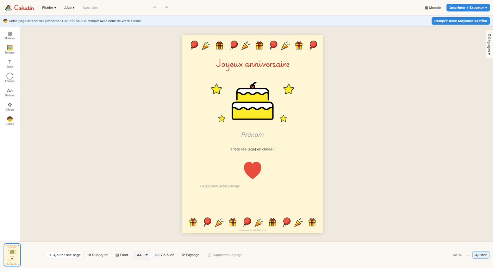

<p align="center"></p>

# Cahutin

Cahutin aide les enseignants de l'école primaire à faire leurs fiches, leurs affiches, leurs étiquettes et leurs pages de cahier de vie : on part d'un modèle, on dépose ses photos, on écrit, et la page est prête à imprimer. Gratuit, libre, et **hors ligne** : aucune donnée ne quitte l'ordinateur, sauf si vous activez l'assistant IA, facultatif (voir « Confidentialité »).



Site : [e-ban.github.io/cahutin](https://e-ban.github.io/cahutin)

> Cahutin est en **bêta** : il est utilisé en classe, mais il peut encore rester des défauts. Les retours sont bienvenus, par « Aide > Signaler un problème » ou par une [issue](https://github.com/e-ban/cahutin/issues).

## Télécharger et installer

### Windows 11

[](https://apps.microsoft.com/detail/9P1VD877KD19?mode=direct)

Le plus simple : [Cahutin sur le Microsoft Store](https://apps.microsoft.com/detail/9P1VD877KD19?mode=direct). Il s'installe en un clic, et le Store le met à jour.

Ou avec l'installeur :

1. Ouvrir la page des [téléchargements](https://github.com/e-ban/cahutin/releases/latest) et télécharger `Cahutin_<version>_x64-setup.exe` de la dernière version.
2. Lancer le fichier. L'installation se fait pour l'utilisateur courant, **sans droits administrateur**.
3. L'installeur n'est pas encore signé : Windows affiche « Windows a protégé votre ordinateur ». Cliquer sur **Informations complémentaires**, puis **Exécuter quand même**.

### Linux

Sur la page des [téléchargements](https://github.com/e-ban/cahutin/releases/latest), deux paquets pour PC 64 bits :

- `Cahutin_<version>_amd64.AppImage`, pour toutes les distributions : le rendre exécutable (`chmod +x Cahutin_*.AppImage`), puis le lancer.
- `Cahutin_<version>_amd64.deb`, pour Debian, Ubuntu et leurs dérivées : `sudo apt install ./Cahutin_<version>_amd64.deb`.

Sous Linux, « Exporter en PDF » n'existe pas : utiliser « Imprimer », puis « Enregistrer en PDF ».

### Vous aviez Carnet

Cahutin est le nouveau nom de Carnet. Installez Cahutin : au premier lancement, il reprend vos modèles personnels et vos polices ajoutées, et vos documents `.carnet` s'ouvrent comme avant. Vous pouvez ensuite désinstaller Carnet.

### Vérifier un téléchargement

Chaque version publie les empreintes `SHA256SUMS` et leur signature GPG `SHA256SUMS.asc`. La marche à suivre, l'équipe et la signature de l'installeur Windows sont décrites dans la [politique de signature (Code signing policy)](https://e-ban.github.io/cahutin/signature.html).

### Mises à jour

Au premier lancement, Cahutin demande s'il doit vous prévenir quand une nouvelle version sort (réglable ensuite dans le menu Aide ou les Préférences). Si vous acceptez, un bandeau l'annonce avec un lien vers la page des téléchargements. Pour changer de version, installer la nouvelle par-dessus l'ancienne : les documents et les modèles personnels sont conservés.

## Ce que Cahutin sait faire

- **Pages** A5, A4 ou A3, en portrait ou en paysage (le contenu suit le format), plusieurs pages par document, vue en vis-à-vis comme un cahier ouvert.
- **Modèles** fournis (Grille de photos, Récit, Page à compléter, Étiquettes, Étiquettes photo, Étiquettes 3 écritures, Photos et textes, Photos légendées, Affiche paysage), modèles pour la classe (Memory et Loto des prénoms, Lettres mobiles, J'écris mon prénom, Tableau des présences, Affiche des anniversaires) et modèles personnels (« Partir d'un modèle » > « Créer un modèle ») à partager entre collègues : chaque texte ou image y est « À remplir » ou « Fixe », et ce qui n'est ni l'un ni l'autre (une photo d'enfant posée avant) n'est pas gardé.
- **Exemples** à découvrir depuis l'écran d'accueil : Sortie à la ferme, Joyeux anniversaire, La météo de la semaine, J'écris mon prénom, Les saisons, Notre semaine (emploi du temps), Le loto des émotions, J'écris les jours, Les règles de la classe (A3), Mes cinq sens, Étiquettes de porte-manteau.
- **Photos** : import d'un dossier entier, photos du document (tiroir Images, une croix pour en retirer une), recadrage, miroir, coins arrondis, bordure, ombre, légende, flou des visages (repérés sur l'ordinateur ou tracés à la main) pour les enfants sans autorisation photo.
- **Textes** : gras, italique, souligné, couleurs, alignement ; polices lisibles pour l'école fournies (Andika, Atkinson Hyperlegible, OpenDyslexic, Playwrite FR Moderne pour la cursive), polices ajoutées et polices installées sur l'ordinateur ; lettres à repasser ou creuses, lignes d'écriture dans un cadre (Seyès, lignes, petits carreaux), styles de texte nommés (Titre, Consigne, Prénom, les vôtres) qui se modifient d'un coup.
- **Classe** : liste des élèves (photo avec autorisation, symbole, niveau, groupe, date de naissance), collée ou importée d'un tableur ou d'un export ONDE (.csv), gardée sur l'ordinateur, avec la photothèque de l'année : les dossiers de photos de l'enseignant, suivis sans être copiés (seules de petites vignettes sont gardées), photos rangées par jour, élèves présents et activités cochés d'un clic (photo en grand, « Marquer un enfant »), enfants peu photographiés signalés. Réglages d'un coup pour une grande classe (autorisation photo, un symbole par enfant, et un même niveau ou un même groupe pour les élèves cochés). Génération d'une page par élève, d'une planche d'étiquettes remplie ou d'une affiche, pour toute la classe, un niveau, un groupe ou les élèves cochés un par un ; champs de la classe posés depuis le tiroir Champs ou le bouton « { } Champ » ({prenom}, {nom}, {groupe}, {age}, {anniversaire}, lettres du prénom), affichés en pastille, imprimés en blanc tant qu'ils ne sont pas remplis ; date (plusieurs formats), année scolaire, saison, classe, école et enseignant, écrits à la pose ou à la création de la page.
- **Tableaux** : cases avec texte, pictogramme ou photo, lignes et colonnes à ajouter ou retirer, cases fusionnées, traits réglables.
- **Formes** : rectangle, ellipse, trait, flèche, étoile, cœur, bulle de parole, nuage ; fiches de graphisme (ponts, vagues, boucles, créneaux… à repasser, à la taille de la section ; pointillés sur toute la ligne, sur une partie ou de moins en moins d'une ligne à l'autre, lignes guides ou couloir, point vert et flèche de départ, réglables même une fois les lignes posées), chemins en pointillés, labyrinthes, dessins à compléter par symétrie, repères pour écrire (point de départ, flèche).
- **Images** : un seul tiroir pour les photos du document (et la photothèque de la classe), la Collection (les dessins et illustrations de l'enseignant, gardés pour tous ses documents ; une image posée s'y ajoute d'un clic ; une page « Ma collection », depuis l'accueil, les range par thème, les renomme et remet les images retirées) et plus de 2 000 pictogrammes OpenMoji avec recherche en français (catégories Rituels, Matériel, Émotions, Corps et soins pour la classe), personnes et mains dans cinq couleurs de peau, images à colorier (contour noir). Une recherche cherche à la fois dans la Collection et les pictogrammes.
- **Décors** : cadres de page et frises (pictogrammes ou images de la collection, taille et espacement réglables, même après coup), dont les images se choisissent dans une fenêtre.
- **Fonds de page** : couleur, Seyès, petits carreaux, lignes, pointillés, papier kraft.
- **Miroir** gauche-droite et haut-bas des photos, images, formes et groupes, en un seul outil de la barre ; rotation par crans de 15° (degré par degré avec Maj) et par quarts de tour. Un panneau Réglages identique pour tout élément ou groupe.
- **Groupes**, y compris des groupes dans des groupes (« Dissocier » n'enlève qu'un niveau, un double-clic entre dans un groupe), sélection au cadre, alignement, répétition d'un bloc en grille, repères de découpe, verrouillage, annulation.
- **Import** : pages d'un autre carnet, et fiches Word (.docx, .doc), LibreOffice (.odt, .odg), PDF ou Publisher (.pub) reprises en textes, photos et formes modifiables ; les tracés d'un PDF (graphisme, cadres) deviennent des formes modifiables (une illustration faite de très nombreux tracés, une image fixe), une police absente est remplacée par une police de même largeur. Un fichier LibreOffice Draw (dont ceux qu'exporte Cahutin) se relit tel quel ; pour les autres formats, LibreOffice doit être installé sur le poste.
- **Aide** : visite guidée au premier lancement ; neuf guides en images (Créer un modèle, Remplir avec ma classe, Photothèque, Flouter des visages, Étiquettes à découper, Reprendre une ancienne fiche, Frise, Ma collection, L'assistant IA), ouverts depuis l'accueil, le menu Aide ou un bouton « Comment faire » sur place, avec un pas à pas « Me guider » qui montre chaque bouton à l'écran ; astuces par thème et bulles d'aide discrètes.
- **Préférences** (en haut de la fenêtre, ou depuis l'accueil), rangées par catégories avec « Chercher un réglage » : thème (Papier, Craie, Crayon, ou Nuit, un thème sombre ; la page reste blanche), taille de l'interface, police des menus (Andika, OpenDyslexic) ; contraste élevé, grandes poignées, animations réduites ; pour le daltonisme, noms des couleurs, repères doublés par un signe, palette d'Okabe et Ito et aperçu « Vision daltonienne » ; barre d'outils en icônes seules ; format et police d'une nouvelle page, section des fiches de graphisme, export proposé en premier. Les préférences restent sur le poste.
- **Interface** : des icônes dessinées (Lucide), livrées avec Cahutin, donc les mêmes sous Windows, macOS et Linux ; l'accueil en deux colonnes, « Commencer » et « Reprendre », avec Ma classe, Ma collection et les Guides en bas.
- **Assistant de mise en page** (à partir de la version 0.13, facultatif et désactivé au départ, Préférences > Assistant) : on écrit ce qu'on veut (« aligne les photos », « fais une fiche d'exercices »), l'assistant prépare une proposition, et rien ne change avant « Accepter ». Cahutin ne fournit pas d'intelligence artificielle : l'assistant se branche sur votre propre service, un compte Claude (Anthropic), OpenAI ou Gemini (Google), en général payant à l'usage, ou Ollama installé sur l'ordinateur. Les textes qu'il écrit (titres, consignes) viennent de l'IA : relisez-les. Une réponse déplacée se signale par « ⚑ Signaler », sous la réponse : un e-mail à l'auteur, prêt dans votre messagerie, sans compte à créer. Ce qu'il envoie : voir « Confidentialité ».
- **Sorties** : impression (chaque page sur une feuille de son format, affiche A3 en deux feuilles A4, cartes en recto-verso), PDF, et export **ODG** pour LibreOffice Draw, où chaque texte, photo et forme reste modifiable et les polices voyagent avec le fichier.

## Confidentialité

**Toutes les données restent sur l'ordinateur.** Cahutin fonctionne sans internet, sans compte et sans serveur (l'assistant IA, facultatif, est la seule exception, détaillée plus bas) :
- les **documents et les photos** (celles des élèves, la photothèque de la classe, la collection d'images) ;
- les **informations personnelles** : prénoms, noms, dates de naissance, groupes, autorisations photo des élèves ;
- les **informations d'utilisation** : Cahutin ne mesure rien, ne compte rien et n'envoie aucune statistique ; ses réglages et son journal restent sur le poste.

En détail :

- Hors assistant IA, une seule connexion possible, facultative et désactivée tant que vous ne l'avez pas acceptée : une fois par jour, Cahutin lit le numéro de la dernière version sur l'API de GitHub (`api.github.com`). Rien d'autre n'est envoyé (ni document, ni identifiant, ni information sur l'ordinateur) ; GitHub voit seulement l'adresse IP de la connexion, comme pour toute visite d'un site. L'interface elle-même n'a accès à aucune adresse distante.
- **Assistant IA (facultatif)**. Désactivé au départ. Une fois activé, il envoie au service que vous avez choisi, et à lui seul, à chaque demande :
  - la disposition des pages : place et taille des éléments, polices, couleurs, fonds, formes, noms des pictogrammes, noms des champs (`{prenom}`, sans le prénom), et si une case photo est remplie ;
  - votre demande, telle que vous l'écrivez, et les échanges de la conversation en cours.

  Il n'envoie jamais les textes des documents, les photos, les noms de fichiers, la liste de la classe (prénoms, dates de naissance, autorisations) ni les noms de vos styles. N'écrivez donc pas de prénom ni d'information sur un élève dans une demande. Le service voit aussi l'adresse IP de la connexion, et traite ce qu'il reçoit selon ses propres conditions, sous votre compte : rien n'est envoyé à l'auteur de Cahutin. Avec Ollama sur l'ordinateur, rien ne sort. La clé du service est enregistrée sur l'ordinateur, dans les réglages de Cahutin (`assistant.json`), et n'est envoyée qu'à l'adresse de ce service, toujours chiffrée (`https://`, sauf pour un service sur l'ordinateur). L'assistant se désactive dans Préférences > Assistant, où « Oublier la clé » l'efface.
- Les métadonnées des photos (lieu, appareil, date) sont retirées à l'import.
- Le repérage des visages, pour flouter ceux des enfants sans autorisation photo, se fait sur l'ordinateur par un modèle intégré à l'application, et seulement avec votre accord. Il trouve où sont les visages, sans jamais reconnaître qui est qui. La photo floutée remplace l'originale dans le document.
- La liste de la classe reste sur l'ordinateur, dans `Documents/Cahutin/Classes`, et sa photothèque dans `Documents/Cahutin/Photos` : les photos restent dans leurs dossiers, Cahutin n'en garde que le chemin, la date de prise de vue et de petites vignettes (ni lieu ni appareil). Les enfants présents sur une photo sont indiqués à la main : aucun visage n'est reconnu.
- Le journal de l'application ne contient ni texte de document, ni nom de fichier, ni prénom d'enfant. Le rapport de problème (Aide > Signaler un problème) reprend seulement ce journal : Cahutin l'enregistre, puis ouvre votre messagerie sur un message à cahutin.pavilion366@slmail.me, où vous le joignez ; c'est vous qui relisez et envoyez, Cahutin n'envoie rien lui-même.
- Les photos importées sont copiées dans un dossier temporaire vidé à la fermeture ; un document enregistré (`.carnet`) contient ses propres photos.
- Une copie de secours du document ouvert est écrite toutes les deux minutes dans le dossier de l'application (`secours`), avec ses photos ; elle est effacée à chaque enregistrement et quand vous quittez le document ; au lancement suivant, Cahutin propose de la reprendre.

## Fichiers

| Extension | Contenu |
|---|---|
| `.carnet` | Carnet fait avec Cahutin : pages, photos, polices ajoutées dont la licence le permet. |
| `.carnet-modele` | Modèle personnel, à copier dans `%APPDATA%\fr.cahutin.app\modeles` (Windows) ou `~/.local/share/fr.cahutin.app/modeles` (Linux) sur un autre poste. |
| `.cahutin-classe` | Liste d'une classe (prénoms, photos et autorisations), rangée dans `Documents/Cahutin/Classes`. |
| Images (`.png`, `.jpg`, `.webp`, `.svg`) | Collection : dans `Documents/Cahutin/Images` ; on peut aussi y déposer des fichiers avec l'explorateur. Une image retirée n'est pas effacée : elle va dans le sous-dossier `Retirées`. Les thèmes sont notés dans `themes.json`, à côté des images. Posée sur une page, une image est copiée dans le carnet. |
| `phototheque.json` | Photothèque d'une classe : dans `Documents/Cahutin/Photos/<classe>`, les dossiers suivis, le chemin de chaque photo, ses élèves présents et ses activités. Les vignettes sont dans le sous-dossier `.vignettes`. Une photo déplacée ou renommée dans un dossier suivi est retrouvée ; une photo absente (clé USB débranchée) garde ses informations pour son retour. |
| `.odg` | Export pour LibreOffice Draw. |

## Développement

Cahutin est écrit en Rust (moteur et application [Tauri 2](https://tauri.app)) et en Svelte 5 (interface).

```
crates/carnet-core   moteur : modèle de document, photos, polices, format .carnet, export ODG
src-tauri            application : fenêtre, commandes, protocole des fichiers locaux
ui                   interface Svelte
assets               polices, images OpenMoji et modèle de repérage des visages embarqués
docs                 recette Windows, feuille de route et capture d'écran
```

Prérequis : Rust stable, Node 26 ; sous Linux, les bibliothèques de WebKitGTK demandées par Tauri ; sous Windows, les Build Tools de Visual Studio (C++).

```sh
npm ci
npm run tauri dev        # application en développement
npm test                 # tests de l'interface
cargo test --workspace   # tests du moteur et de l'application
npm run tauri build      # installeur Windows (sous Linux : -- --bundles appimage,deb)
```

Le banc de fidélité exporte des pages en ODG et les fait rendre par LibreOffice pour vérifier qu'elles sont identiques à l'écran (LibreOffice doit être installé ; l'intégration continue lance le premier à chaque envoi) :

```sh
cargo test -p carnet-core --test odg_libreoffice -- --ignored --test-threads=1
cargo test -p carnet-core --test import_libreoffice -- --ignored --test-threads=1   # import par LibreOffice
```

Le banc d'essai de l'assistant joue une vingtaine de demandes types (mise en page, courts textes, détournements, hors sujet) avec un vrai service. Il note ce que chacune coûte en tokens et si l'assistant reste dans son rôle, et écrit son relevé dans `docs/assistant/`. Il dépense des tokens. La clé ne vient que de l'environnement :

```sh
CAHUTIN_BANC_URL=https://api.openai.com/v1 CAHUTIN_BANC_MODEL=gpt-6-luna CAHUTIN_BANC_KEY=… \
  cargo test -p carnet-app --lib bench -- --ignored --nocapture
```

Dans l'application, chaque demande à l'assistant écrit au journal une ligne `assistant_usage` (échanges, appels d'outils, tokens envoyés, reçus, lus et écrits en cache), sans la demande ni la réponse. Avec Claude (`https://api.anthropic.com`), Cahutin passe par l'API Messages d'Anthropic plutôt que par sa porte compatible OpenAI : la consigne et les outils, renvoyés à chaque échange, y sont gardés en cache (`src-tauri/src/assistant/anthropic.rs`).

Les captures d'écran (README, site, Store, nouveautés) se refont à chaque version avec `scripts/captures/capturer.sh <dossier>` : il lance l'application de développement dans un écran virtuel, pilotée par tauri-driver, avec un dossier personnel jetable, ouvre les exemples (une photo de test est générée) et capture chaque scène de `scripts/captures/scenes.mjs`. Les images des guides se refont de même avec `GUIDES=1 scripts/captures/capturer.sh assets/guides` (scènes de `scripts/captures/guides.mjs`, images de test dessinées par `images.sh`, encadrés orange sur les boutons désignés). Il demande tauri-driver, WebKitWebDriver, xvfb-run et ImageMagick ; les images de l'assistant, Ollama et le modèle qwen3:4b.

Les types TypeScript de `ui/src/lib/gen` sont produits par le moteur (ts-rs) lors de `cargo test`.

### Publier une version

1. Vérifier que tout ce que la version apporte est expliqué :
   - **documentation** : ce README (« Ce que Cahutin sait faire », « Confidentialité », « Fichiers », « Mentions ») ;
   - **aide de l'application** : visite guidée (`ui/src/lib/tour.svelte.ts`), astuces (`ui/src/lib/tips.ts`), bulles d'aide (`ui/src/lib/hints.svelte.ts`), et la fenêtre des nouveautés : une entrée en tête de `RELEASES` dans `ui/src/lib/whatsNew.ts`, ses captures dans `assets/nouveautes/<version>/` ;
   - **site** : `site/index.html` (publié par le workflow « Site » à l'envoi sur `main`).
2. Mettre la version dans `Cargo.toml` (`[workspace.package]`) et `package.json`, puis lancer `cargo check` et `npm install --package-lock-only` pour mettre à jour `Cargo.lock` et `package-lock.json`.
3. Renommer la section `## Non publié` de `CHANGELOG.md` en `## <version>`.
4. Valider, puis créer le tag signé et tout envoyer : `git tag -s v<version> -m "Cahutin <version> (bêta)"` et `git push origin main v<version>`.

Le workflow « Construction » lance les tests sous Windows et Linux, construit les installeurs et publie la release avec ses empreintes (`SHA256SUMS`) et la section du journal des versions. Une fois la release publiée, signer les empreintes : `scripts/sign-release.sh v<version>`. Il refuse un tag qui ne correspond pas à la version de l'application ou qui n'a pas de section dans `CHANGELOG.md`.

Microsoft Store : la CI construit aussi `Cahutin_<version>_x64.msix` (`scripts/build-msix.ps1`, manifeste dans `packaging/msix`), une version sans avis de nouvelle version (`CAHUTIN_STORE=1`) que le Store signe et met à jour. L'identité du paquet vient des variables du dépôt `STORE_IDENTITY_NAME`, `STORE_PUBLISHER` et `STORE_PUBLISHER_DISPLAY` (Partner Center > Gestion des produits > Identité du produit). À chaque version, envoyer l'artefact `cahutin-msix-…` du workflow dans une nouvelle soumission Partner Center.

## Contribuer

Signalements, idées et code sont bienvenus : voir [CONTRIBUTING.md](CONTRIBUTING.md) et le [code de conduite](CODE_OF_CONDUCT.md). Une faille de sécurité se signale en privé : voir [SECURITY.md](SECURITY.md).

## Mentions

- Images : [OpenMoji](https://openmoji.org), licence CC BY-SA 4.0 ; mots-clés français issus de [Unicode CLDR](https://cldr.unicode.org) (licence Unicode). Une page qui contient une image porte la mention « Pictogrammes : OpenMoji, CC BY-SA 4.0 ».
- Icônes de l'interface : [Lucide](https://lucide.dev), licence ISC.
- Repérage des visages : [YuNet](https://github.com/opencv/opencv_zoo/tree/main/models/face_detection_yunet) (OpenCV Zoo), licence MIT, exécuté par [tract](https://github.com/sonos/tract).
- Polices fournies : licence SIL Open Font License 1.1 (fichiers `OFL.txt` dans `assets/fonts`).

## Licence

Cahutin est un logiciel libre, sous [Licence publique de l'Union européenne (EUPL) 1.2](LICENSE), texte officiel en français. Toute version modifiée et diffusée doit rester libre, sous la même licence ou une licence compatible.

Les images, les polices et les mots-clés fournis gardent leur propre licence (voir Mentions).
