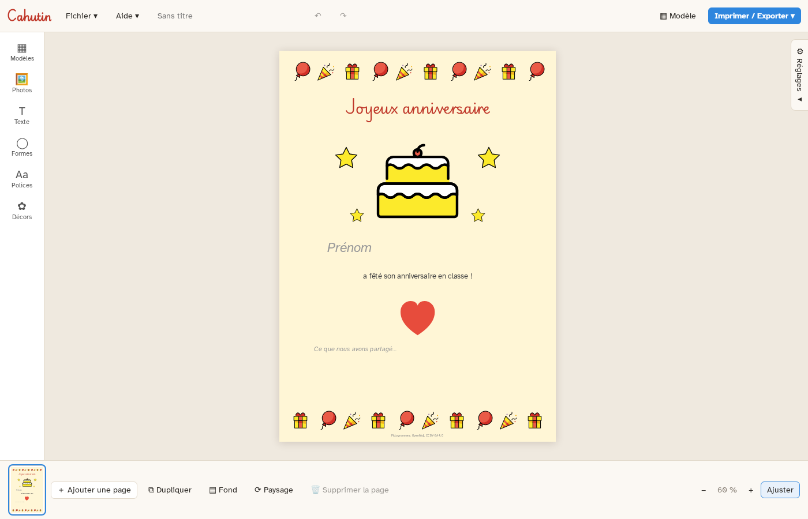

# Cahutin

Cahutin aide les enseignants de l'école primaire à faire leurs fiches, leurs affiches, leurs étiquettes et leurs pages de cahier de vie : on part d'un modèle, on dépose ses photos, on écrit, et la page est prête à imprimer. Gratuit, libre, et **hors ligne** : aucun document ne quitte l'ordinateur.



> Cahutin est en **bêta** : il est utilisé en classe, mais il peut encore rester des défauts. Les retours sont bienvenus, par « Aide > Signaler un problème » ou par une [issue](https://github.com/e-ban/cahutin/issues).

## Télécharger et installer

### Windows 11

1. Ouvrir la page des [téléchargements](https://github.com/e-ban/cahutin/releases/latest) et télécharger `Cahutin_<version>_x64-setup.exe` de la dernière version.
2. Lancer le fichier. L'installation se fait pour l'utilisateur courant, **sans droits administrateur**.
3. L'installeur n'est pas encore signé : Windows affiche « Windows a protégé votre ordinateur ». Cliquer sur **Informations complémentaires**, puis **Exécuter quand même**.

### Linux

Sur la page des [téléchargements](https://github.com/e-ban/cahutin/releases/latest), deux paquets pour PC 64 bits :

- `Cahutin_<version>_amd64.AppImage`, pour toutes les distributions : le rendre exécutable (`chmod +x Cahutin_*.AppImage`), puis le lancer.
- `Cahutin_<version>_amd64.deb`, pour Debian, Ubuntu et leurs dérivées : `sudo apt install ./Cahutin_<version>_amd64.deb`.

Sous Linux, « Exporter en PDF » n'existe pas : utiliser « Imprimer », puis « Enregistrer en PDF ».

### Vous aviez Carnet

Cahutin est le nouveau nom de Carnet. Installez Cahutin : au premier lancement, il reprend vos modèles personnels et vos polices ajoutées, et vos documents `.carnet` s'ouvrent comme avant. Vous pouvez ensuite désinstaller Carnet.

### Mises à jour

Au premier lancement, Cahutin demande s'il doit vous prévenir quand une nouvelle version sort (réglable ensuite dans le menu Aide). Si vous acceptez, un bandeau l'annonce avec un lien vers la page des téléchargements. Pour changer de version, installer la nouvelle par-dessus l'ancienne : les documents et les modèles personnels sont conservés.

## Ce que Cahutin sait faire

- **Pages** A4 en portrait ou en paysage, plusieurs pages par document.
- **Modèles** fournis (Grille de photos, Récit, Page à compléter, Étiquettes, Étiquettes photo, Photos et textes, Photos légendées, Affiche paysage) et modèles personnels à partager entre collègues.
- **Exemples** à découvrir depuis l'écran d'accueil : Sortie à la ferme, Joyeux anniversaire, La météo de la semaine, J'écris mon prénom, Les saisons.
- **Photos** : import d'un dossier entier, photothèque du document, recadrage, coins arrondis, bordure, ombre, légende.
- **Textes** : gras, italique, souligné, couleurs, alignement ; polices lisibles pour l'école fournies (Andika, Atkinson Hyperlegible, OpenDyslexic, Playwrite FR Moderne pour la cursive), polices ajoutées et polices installées sur l'ordinateur.
- **Formes** : rectangle, ellipse, trait, flèche, étoile, cœur, bulle de parole, nuage.
- **Décors** : plus de 2 000 images OpenMoji avec recherche en français, cadres de page et frises.
- **Fonds de page** : couleur, Seyès, petits carreaux, lignes, pointillés, papier kraft.
- **Groupes**, sélection au cadre, alignement, verrouillage, annulation.
- **Import** : pages d'un autre carnet, et fiches Word (.docx, .doc), LibreOffice (.odt, .odg), PDF ou Publisher (.pub) reprises en textes, photos et formes modifiables. Pour ces formats, LibreOffice doit être installé sur le poste.
- **Aide** : visite guidée au premier lancement, astuces par thème et bulles d'aide discrètes (menu Aide).
- **Sorties** : impression, PDF, et export **ODG** pour LibreOffice Draw, où chaque texte, photo et forme reste modifiable et les polices voyagent avec le fichier.

## Confidentialité

- Une seule connexion possible, facultative et désactivée tant que vous ne l'avez pas acceptée : une fois par jour, Cahutin lit le numéro de la dernière version sur l'API de GitHub (`api.github.com`). Rien d'autre n'est envoyé (ni document, ni identifiant, ni information sur l'ordinateur) ; GitHub voit seulement l'adresse IP de la connexion, comme pour toute visite d'un site. L'interface elle-même n'a accès à aucune adresse distante.
- Les métadonnées des photos (lieu, appareil, date) sont retirées à l'import.
- Le journal de l'application ne contient ni texte de document, ni nom de fichier, ni prénom d'enfant. Le rapport de problème (Aide > Signaler un problème) reprend seulement ce journal.
- Les photos importées sont copiées dans un dossier temporaire vidé à la fermeture ; un document enregistré (`.carnet`) contient ses propres photos.

## Fichiers

| Extension | Contenu |
|---|---|
| `.carnet` | Carnet fait avec Cahutin : pages, photos, polices ajoutées dont la licence le permet. |
| `.carnet-modele` | Modèle personnel, à copier dans `%APPDATA%\fr.cahutin.app\modeles` (Windows) ou `~/.local/share/fr.cahutin.app/modeles` (Linux) sur un autre poste. |
| `.odg` | Export pour LibreOffice Draw. |

## Développement

Cahutin est écrit en Rust (moteur et application [Tauri 2](https://tauri.app)) et en Svelte 5 (interface).

```
crates/carnet-core   moteur : modèle de document, photos, polices, format .carnet, export ODG
src-tauri            application : fenêtre, commandes, protocole des fichiers locaux
ui                   interface Svelte
assets               polices et images OpenMoji embarquées
docs                 recette Windows et capture d'écran
```

Prérequis : Rust stable, Node 26 ; sous Linux, les bibliothèques de WebKitGTK demandées par Tauri ; sous Windows, les Build Tools de Visual Studio (C++).

```sh
npm ci
npm run tauri dev        # application en développement
npm test                 # tests de l'interface
cargo test --workspace   # tests du moteur et de l'application
npm run tauri build      # installeur Windows (sous Linux : -- --bundles appimage,deb)
```

Le banc de fidélité exporte des pages en ODG et les fait rendre par LibreOffice pour vérifier qu'elles sont identiques à l'écran (LibreOffice doit être installé) :

```sh
cargo test -p carnet-core --test odg_libreoffice -- --ignored --test-threads=1
cargo test -p carnet-core --test import_libreoffice -- --ignored --test-threads=1   # import par LibreOffice
```

Les types TypeScript de `ui/src/lib/gen` sont produits par le moteur (ts-rs) lors de `cargo test`.

### Publier une version

1. Mettre la version dans `Cargo.toml` (`[workspace.package]`) et `package.json`, puis lancer `cargo check` pour mettre à jour `Cargo.lock`.
2. Ajouter une section `## <version>` en tête de `CHANGELOG.md`.
3. Valider, puis créer et envoyer le tag : `git tag v<version>` et `git push origin main v<version>`.

Le workflow « Construction » lance les tests sous Windows et Linux, construit les installeurs et publie la release avec la section du journal des versions. Il refuse un tag qui ne correspond pas à la version de l'application ou qui n'a pas de section dans `CHANGELOG.md`.

## Mentions

- Images : [OpenMoji](https://openmoji.org), licence CC BY-SA 4.0 ; mots-clés français issus de [Unicode CLDR](https://cldr.unicode.org) (licence Unicode). Une page qui contient une image porte la mention « Pictogrammes : OpenMoji, CC BY-SA 4.0 ».
- Polices fournies : licence SIL Open Font License 1.1 (fichiers `OFL.txt` dans `assets/fonts`).

## Licence

Cahutin est un logiciel libre, sous [Licence publique de l'Union européenne (EUPL) 1.2](LICENSE), texte officiel en français. Toute version modifiée et diffusée doit rester libre, sous la même licence ou une licence compatible.

Les images, les polices et les mots-clés fournis gardent leur propre licence (voir Mentions).
